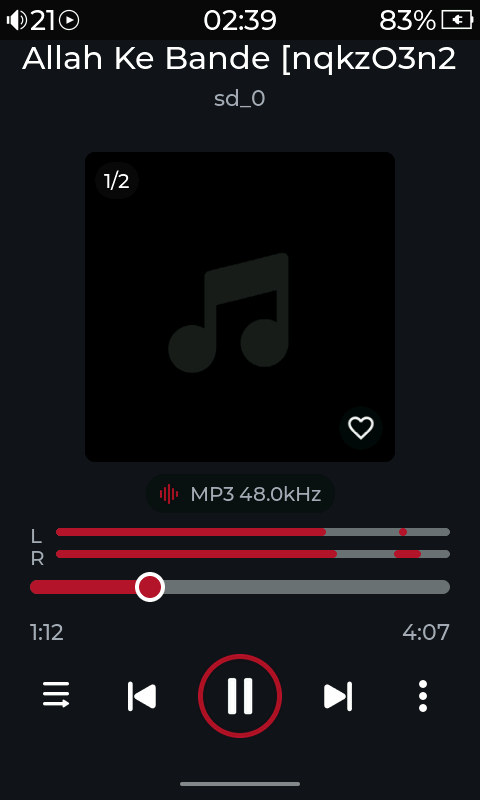
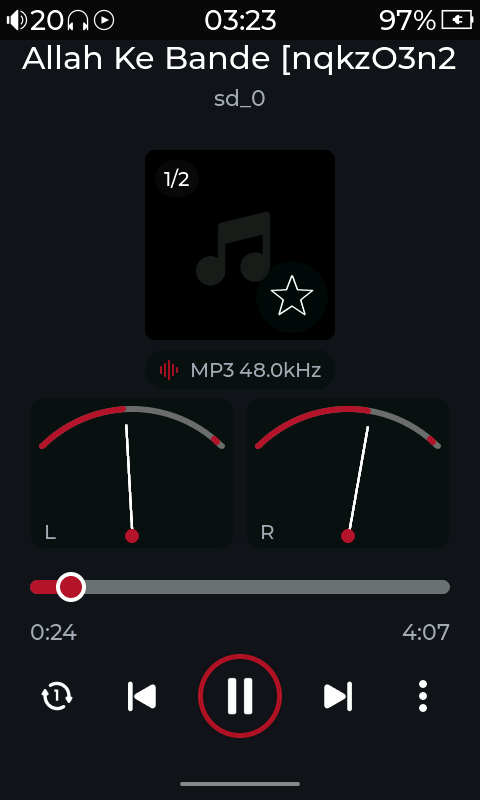
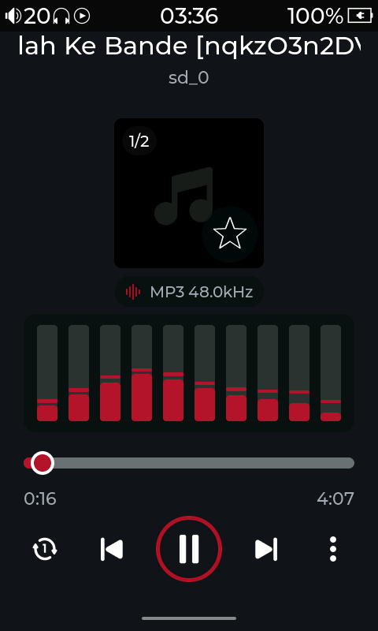

# VU meters and a spectrum for CompásOS

Level meters for the Now Playing screen of
[CompásOS](https://github.com/Starnished66/compas-player) on the HiBy R1:
two bars, two round dials with needles, or a ten-band spectrum, drawn flat
in the theme's accent and moving with what you hear.

| Bars | Dials | Spectrum |
|---|---|---|
|  |  |  |

## Why it is two patches and not just a plugin

A CompásOS plugin has no access to audio levels, and an external app stops
the music. So the meter is a small addition to the player itself, and a
plugin that ships three Now Playing layouts using it:

| Folder | What | For |
|---|---|---|
| `for-compas-player/` | the patch and its pull request text | [compas-player](https://github.com/Starnished66/compas-player), on v1.6.0 |
| `for-compas-plugins/` | the patch and its pull request text | [compas-plugins](https://github.com/Starnished66/compas-plugins) |
| `plugin/` | the plugin's files as they go on the card | `<card>/.plugins/` |
| `NOTE_TO_COMPAS_DEV.md` | the covering note | |

Until the player change is part of a CompásOS release, the plugin alone does
nothing: on a stock player it installs and offers no layouts.

## Trying it now

You need a player built with the patch.

1. Build CompásOS v1.6.0 with `for-compas-player/0001-…patch` applied
   (`git am`, then `make target` with the CompásOS toolchain).
2. Save the result as `<card>/.compas/compas_player` and restart the
   player. This is CompásOS's own SD-card update: it installs the build in
   place of the current player. A later official update replaces it again.
3. Copy everything in `plugin/` into `<card>/.plugins/`:

   ```
   <card>/.plugins/VUMeterPlayer.lua
   <card>/.plugins/VUMeterPlayer/player_layouts/...
   ```

4. **Settings > Personalize > Player Layout**, and pick **VU Meter Player**,
   **VU Dial Player** or **VU Spectrum Player**.
5. On Now Playing, swipe left or right across the meter (or tap it) to move
   between the three.

## State

Run on one HiBy R1, on v1.5.1 with the change ported and on v1.6.0, through
the headphone socket. What has and has not been tested, the processor cost,
and one display problem met on v1.5.1 (and why it is v1.5.1's) are in
`for-compas-player/PR_DESCRIPTION.md`. In short: the timing has only been
judged by eye; Bluetooth and USB output, hi-res and mono files, long runs
and the lyrics pane are untried; only the 480x800 layouts have been seen on
a device; and the spectrum costs noticeably more processor time than the
other two.

GPL-3.0-or-later, like CompásOS.
